# Adaptive Helical Flight Sparrow Search Algorithm

This issue brings together a study by Ouyang C et al., proposing an Adaptive Spiral Flying Sparrow Search Algorithm (ASFSSA) based on the Sparrow Search Algorithm. The authors introduce four strategies to enhance the algorithm's convergence precision and avoid local optima.
References: Ouyang C, Qiu Y, Zhu D. Adaptive spiral flying sparrow search algorithm [J]. Scientific Programming, 2021, 2021: 1-16.
The original Sparrow Search Algorithm has many principles online, which are not elaborated upon in this article. Instead, we will directly discuss the improved strategies of the ASFSSA.
① Chaos Map Strategy
In the paper, the tent chaos map is used to initialize particles in the Sparrow Search Algorithm. As for the chaos mapping, there have been many previous articles discussing it, so here we will not go into detail. You can refer to this article: 10 types of chaos mapping optimization grey wolf algorithms, which can be switched on one click, applicable to optimize all population-based intelligent algorithms.
② Adaptive Weighting Strategy
By introducing adaptive weights, the quality of discoverer individual positions can be enhanced, allowing other individuals to converge to the optimal position faster and accelerating the convergence speed. The formula for adaptive weights is as follows:
The formula for updating the discoverer's position is as follows:
By introducing adaptive weights, the positions of the sparrows are dynamically adjusted through different guidance modes at different times, enhancing the algorithm's search flexibility. As iterations increase, the individual sparrows towards the best position converge, with larger weights leading to faster individual movements, thus improving the algorithm's convergence speed.
③ Levy Flight Strategy
The Levy flight strategy is employed after the discovery position update, which combines the Levy flight mechanism with adaptive weights to balance the search method. This enhances the quality of each obtained solution significantly, thereby significantly enhancing the algorithm's search capability. The Levy flight formula is as follows:  
④Variable spiral search strategy  
The spiral search is based on the whale algorithm, and by changing the spiral search factor dynamically, it can improve the search efficiency of the algorithm. During the follower position update phase, a variable spiral position update strategy is introduced, making the follower position update more flexible and balancing the algorithm's global and local search. The formula for the variable spiral position update strategy is as follows:  
In this formula, parameters vary with the number of operations, and the size and amplitude of the spiral line are dynamically adjusted according to the function's property.  
The adaptive spiral flight sparrow search algorithm has been tested on CEC2005 as follows:  
An original sparrow algorithm and an improved sparrow algorithm were iterated 500 times respectively, with 30 sparrows set, each function run 30 times, and five indicators such as optimal value, worst value, average value, variance, and median were calculated.
F1Function calculation results: \nSSA: Optimal value:4.3074e-272 Worst value:3.435e-70 Mean:1.2104e-71 Variance:6.2663e-71 Median:1.8503e-90\nASFSSA: Optimal value:0 Worst value:0 Mean:0 Variance:0 Median:0\nF2Function calculation results: \nSSA: Optimal value:3.0364e-66 Worst value:3.3144e-36 Mean:1.2236e-37 Variance:6.0434e-37 Median:7.4176e-44\nASFSSA: Optimal value:4.6839e-193 Worst value:4.9652e-178 Mean:1.6595e-179 Variance:0 Median:7.3611e-187\nF3Function calculation results: \nSSA: Optimal value:0 Worst value:3.5193e-34 Mean:1.4068e-35 Variance:6.508e-35 Median:1.2581e-44\nASFSSA: Optimal value:0 Worst value:0 Mean:0 Variance:0 Median:0\nF4Function calculation results: \nSSA: Optimal value:8.1653e-177 Worst value:9.6852e-30 Mean:5.3915e-31 Variance:1.838e-30 Median:1.892e-41\nASFSSA: Optimal value:6.776e-301 Worst value:5.8606e-167 Mean:1.9535e-168 Variance:0 Median:1.1965e-178\nF5Function calculation results: \nSSA: Optimal value:5.7208e-11 Worst value:0.00028058 Mean:1.5325e-05 Variance:5.3195e-05 Median:3.232e-07\nASFSSA: Optimal value:1.855e-08 Worst value:0.10666 Mean:0.0039251 Variance:0.019419 Median:3.118e-05\nF6Function calculation results: \nSSA: Optimal value:0 Worst value:7.7037e-32 Mean:9.3472e-33 Variance:1.5365e-32 Median:3.0815e-33\nASFSSA: Optimal value:0 Worst value:4.9304e-32 Mean:8.6282e-33 Variance:1.2337e-32 Median:3.0815e-33\nF7Function calculation results: \nSSA: Optimal value:0.00011095 Worst value:0.0049268 Mean:0.0011296 Variance:0.0010227 Median:0.00089266\nASFSSA: Optimal value:1.0841e-06 Worst value:0.0018575 Mean:0.00032377 Variance:0.0004119 Median:0.00016401\nF8Function calculation results: \nSSA: Optimal value:-3952.9522 Worst value:-2668.2847 Mean:-3262.8123 Variance:327.1847 Median:-3261.2452\nASFSSA: Optimal value:-4189.8289 Worst value:-3117.8156 Mean:-3603.3574 Variance:302.5694 Median:-3684.9435\nF9Function calculation results: \nSSA: Optimal value:0 Worst value:0 Mean:0 Variance:0 Median:0\nASFSSA: Optimal value:0 Worst value:0 Mean:0 Variance:0 Median:0\nF10Function calculation results: \nSSA: Optimal value:4.4409e-16 Worst value:4.4409e-16 Mean:4.4409e-16 Variance:0 Median:4.4409e-16\nASFSSA: Optimal value:4.4409e-16 Worst value:4.4409e-16 Mean:4.4409e-16 Variance:0 Median:4.4409e-16\nF11Function calculation results: \nSSA: Optimal value:0 Worst value:0 Mean:0 Variance:0 Median:0\nASFSSA: Optimal value:0 Worst value:0 Mean:0 Variance:0 Median:0\nF12Function calculation results: \nSSA: Optimal value:4.7116e-32 Worst value:4.9052e-32 Mean:4.7738e-32 Variance:6.3457e-34 Median:4.7721e-32\nASFSSA: Optimal value:4.7116e-32 Worst value:6.2606e-32 Mean:4.9674e-32 Variance:3.8449e-33 Median:4.8205e-32\nF13Function calculation results: \nSSA: Optimal value:1.3498e-32 Worst value:3.3219e-32 Mean:1.7196e-32 Variance:5.6252e-33 Median:1.3498e-32\nASFSSA: Optimal value:1.3498e-32 Worst value:1.1619e-29 Mean:4.0982e-31 Variance:2.1174e-30 Median:1.473e-32\nF14Function calculation results: \nSSA: Optimal value:0.998 Worst value:12.6705 Mean:6.3206 Variance:5.6898 Median:1.9901\nASFSSA: Optimal value:0.998 Worst value:12.6705 Mean:5.6798 Variance:5.228 Median:2.9821\nF15Function calculation results: \nSSA: Optimal value:0.00030749 Worst value:0.00057747 Mean:0.00032635 Variance:6.2713e-05 Median:0.00030749\nASFSSA: Optimal value:0.00030749 Worst value:0.0012232 Mean:0.00071963 Variance:0.00042443 Median:0.00047542\nF16Function calculation results: \nSSA: Optimal value:-1.0316 Worst value:-1.0316 Mean:-1.0316 Variance:5.6082e-16 Median:-1.0316\nASFSSA: Optimal value:-1.0316 Worst value:-1.0316 Mean:-1.0316 Variance:4.7373e-16 Median:-1.0316\nF17Function calculation results: \nSSA: Optimal value:0.39789 Worst value:0.39789 Mean:0.39789 Variance:0 Median:0.39789\nASFSSA: Optimal value:0.39789 Worst value:0.39789 Mean:0.39789 Variance:0 Median:0.39789\nF18Function calculation results: \nSSA: Optimal value:3 Worst value:30 Mean:3.9 Variance:4.9295 Median:3\nASFSSA: Optimal value:3 Worst value:3 Mean:3 Variance:1.9305e-15 Median:3\nF19Function calculation results: \nSSA: Optimal value:-3.8628 Worst value:-3.0898 Mean:-3.837 Variance:0.14113 Median:-3.8628\nASFSSA: Optimal value:-3.8628 Worst value:-3.8628 Mean:-3.8628 Variance:2.2599e-15 Median:-3.8628\nF20Function calculation results: \nSSA: Optimal value:-3.322 Worst value:-3.2031 Mean:-3.2863 Variance:0.055415 Median:-3.322\nASFSSA: Optimal value:-3.322 Worst value:-3.2031 Mean:-3.2779 Variance:0.057935 Median:-3.322\nF21Function calculation results: \nSSA: Optimal value:-10.1532 Worst value:-5.0552 Mean:-8.2839 Variance:2.4987 Median:-10.1532\nASFSSA: Optimal value:-10.1532 Worst value:-5.0552 Mean:-7.0604 Variance:2.3849 Median:-5.0552\nF22Function calculation results: \nSSA: Optimal value:-10.4029 Worst value:-5.0877 Mean:-9.3388 Variance:2.1619 Median:-10.4029\nASFSSA: Optimal value:-10.4029 Worst value:-5.0877 Mean:-6.8024 Variance:2.4436 Median:-5.0877\nF23Function calculation results: \nSSA: Optimal value:-10.5364 Worst value:-5.1285 Mean:-8.914 Variance:2.5206 Middle value:-10.5364\nASFSSA: Optimal value:-10.5364 Worst value:-5.1285 Average:-6.163 Variance:2.1086 Median:-5.1285\n  
Code Exhibition
The code is strictly reproduced from the original paper. The complete code is as follows, and you can directly copy and paste it. (Note that it needs to be used with CEC functions; there have been many articles on how to call CEC functions in previous posts, so I won't go into detail here)
% The code strictly replicates the paper.\nfunction [fMin , bestX,Convergence_curve ] = ASFSSA(pop, M,c,d,dim,fobj  )\n\n   P_percent = 0.2;    % The population size of producers accounts for "P_percent" percent of the total population size       \n\n\n%%%%%%%%%%%%%%%%%%%%%%%%%%%%%%%%%%%%%%%%%%%%%%%%%%%%%%\npNum = round( pop *  P_percent );    % The population size of the producers   \n\n\nlb= c.*ones( 1,dim );    % Lower limit/bounds/     a vector\nub= d.*ones( 1,dim );    % Upper limit/bounds/     a vector\n%Initialization\n     N = pop*dim;\n     z(1)=rand;\n    for k=1:N\n         z(k+1) = mod(2 * z(k)+rand * (1/N),1);\n\n    end\n       for i = 1 : pop\n         for j=1:dim\n             G(i,j) = z((i-1)*dim+j+1); \n             x(i,j) = lb(j) + (ub(j) - lb(j)) * G(i,j); \n         end\n          fit( i ) = fobj( x( i, : ) ) ;  \n        end\n\n\npFit = fit;                      \npX = x;                            % The individual's best position corresponding to the pFit\n[ fMin, bestI ] = min( fit );      % fMin denotes the global optimum fitness value\nbestX = x( bestI, : );             % bestX denotes the global optimum position corresponding to fMin\n\n\n % Start updating the solutions.\n\nfor t = 1 : M    \n\n  [ ans, sortIndex ] = sort( pFit );% Sort.\n  [fmax,B]=max( pFit );\n   worse= x(B,:);  \n\n   r2=rand(1);\n   w = 0.2 * cos(pi/2 * (1-(t/M)));\nif(r2<0.8)\n    for i = 1 : pNum                                                   % Equation (3)\n         r1=rand(1);\n        x( sortIndex( i ), : ) = w * pX( sortIndex( i ), : )*exp(-(i)/(r1*M));\n        x( sortIndex( i ), : ) = Bounds( x( sortIndex( i ), : ), lb, ub );\n        fit( sortIndex( i ) ) = fobj( x( sortIndex( i ), : ) ); \n    end\nelse\n   for i = 1 : pNum        \n      x( sortIndex( i ), : ) = w * pX( sortIndex( i ), : )+randn(1)*ones(1,dim); \n      x( sortIndex( i ), : ) = Bounds( x( sortIndex( i ), : ), lb, ub );\n      fit( sortIndex( i ) ) = fobj( x( sortIndex( i ), : ) ); \n      end\nend\n  [ ~, bestII ] = min( fit );      \n  bestXX = x( bestII, : );          \n for i = 1 : pNum   \n   x(sortIndex( i ), : ) = func_levy( x( sortIndex( i ), : ),bestXX  );  \n   x( sortIndex( i ), : ) = Bounds( x( sortIndex( i ), : ), lb, ub );\n   fit( sortIndex( i ) ) = fobj( x( sortIndex( i ), : ) );   \n end    \n   [ ~, bestII ] = min( fit );      \n   bestXX = x( bestII, : );\n   for i = ( pNum + 1 ) : pop                     % Equation (4)\n         k=5;\n         A=floor(rand(1,dim)*2)*2-1;\n         sz =[1,dim];\n          L = unifrnd(-1,1,sz);\n          xb(i,:) = bestXX+(abs(( pX( sortIndex( i ), : )-bestXX)))*(A'*(A*A')^(-1))* L;\n          z = exp(k*cos(pi*(1-(t/M))));\n          if( i>(pop/2))\n              for j = 1:dim \n                 l = 0.01 .*( x( sortIndex(i),j) - bestXX(j));\n                 x( sortIndex(i) , j )=exp(z*l) * cos(2*pi*l) * randn(1)*exp((worse(j)-pX( sortIndex( i ), j ))/(i)^2);\n              end\n          else\n            for j = 1:dim \n              l = 0.01 .*( x( sortIndex(i),j) - bestXX(j));\n              x( sortIndex(i) , j ) = xb(i,j) * exp(z*l) * cos(2*pi*l);\n            end       \n         end  \n        x( sortIndex( i ), : ) = Bounds( x( sortIndex( i ), : ), lb, ub );\n        fit( sortIndex( i ) ) = fobj( x( sortIndex( i ), : ) );    \n   end\n  c=randperm(numel(sortIndex));\n   b=sortIndex(c(1:20));\n    for j =  1  : length(b)      % Equation (5)\n\n        if( pFit( sortIndex( b(j) ) )>(fMin) )\n\n            x( sortIndex( b(j) ), : )=bestX+(randn(1,dim)).*(abs(( pX( sortIndex( b(j) ), : ) -bestX)));\n\n        else\n\n            x( sortIndex( b(j) ), : ) =pX( sortIndex( b(j) ), : )+(2*rand(1)-1)*(abs(pX( sortIndex( b(j) ), : )-worse))/ ( pFit( sortIndex( b(j) ) )-fmax+1e-50);\n\n        end\n            x( sortIndex(b(j) ), : ) = Bounds( x( sortIndex(b(j) ), : ), lb, ub );\n\n            fit( sortIndex( b(j) ) ) = fobj( x( sortIndex( b(j) ), : ) );\n    end\n    for i = 1 : pop \n        if ( fit( i ) < pFit( i ) )\n            pFit( i ) = fit( i );\n            pX( i, : ) = x( i, : );\n        end\n\n        if( pFit( i ) < fMin )\n           fMin= pFit( i );\n           bestX = pX( i, : );\n        end\n    end\n\n    Convergence_curve(t)=fMin;\n\nend\n\n\n% Application of simple limits/bounds\nfunction s = Bounds( s, Lb, Ub)\n  % Apply the lower bound vector\n  temp = s;\n  I = temp < Lb;\n  temp(I) = Lb(I);\n\n  % Apply the upper bound vector \n  J = temp > Ub;\n  temp(J) = Ub(J);\n  % Update this new move \n  s = temp;\nComplete code link:   
Link: https://pan.baidu.com/s/1gRHRJijsdl12eV9XM4qpxQ?pwd=g7h9

## Images

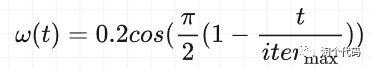
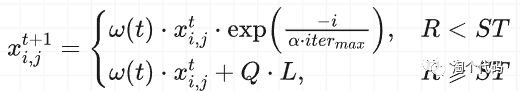
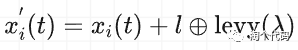
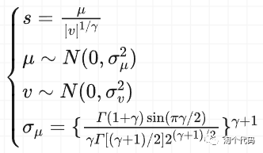
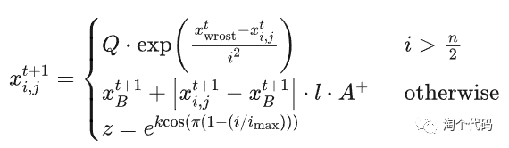
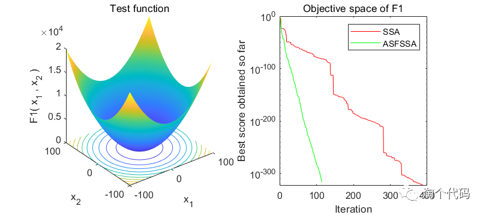
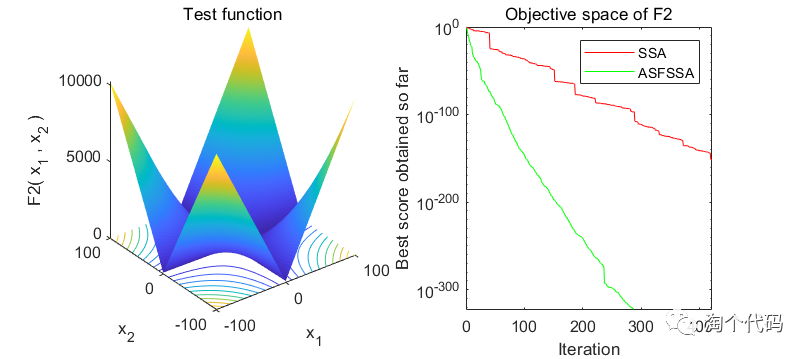
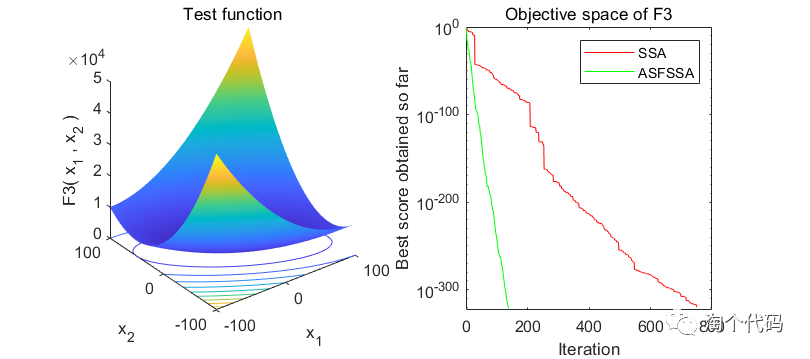
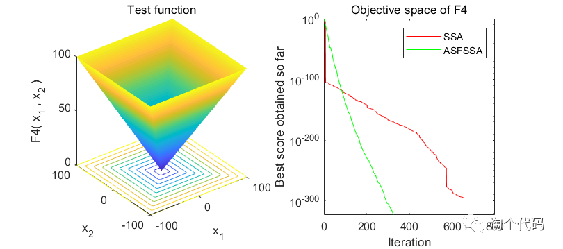
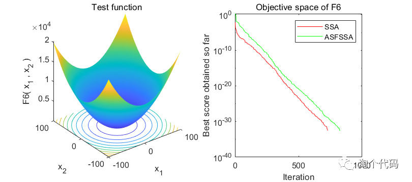
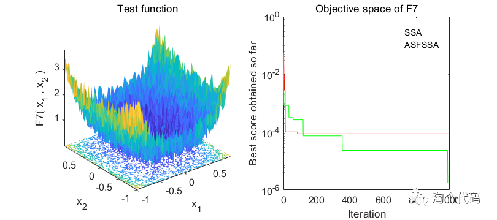
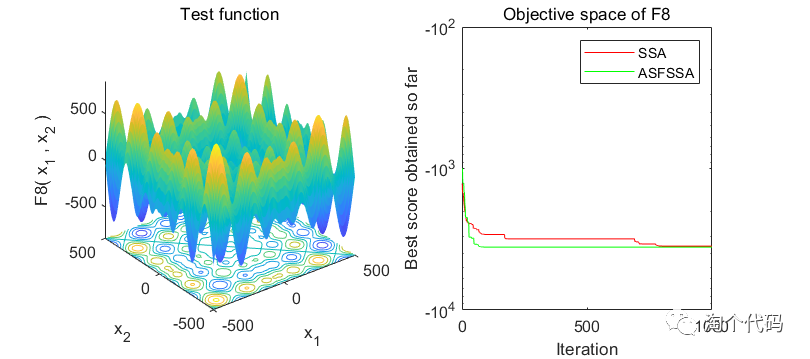

<!-- PAYMENT_BLOCK -->

## Get this dataset

- Payment link (Stripe): [Buy now](https://buy.stripe.com/3cs8yP7sY87d0vu9AB)
- Payment QR code: 

<!-- /PAYMENT_BLOCK -->
